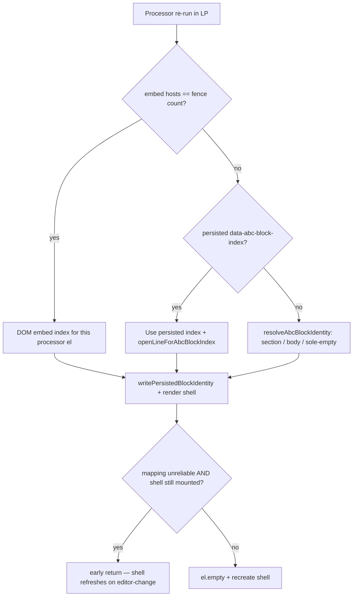

# Phase 4.5 — Multi-block Live Preview identity (resolved)

**Status:** Fixed and manually verified (plugin **v0.1.5**, June 2026).  
**Audience:** Future agents and maintainers working on `obsidian-abc-blocks`.  
**Canonical reference:** This file is the detailed fix write-up. `DESIGN.md` and `HANDOFF-phase-4.5-multi-block.md` link here for status and historical context.

---

## What Phase 4.5 requires

In a note with **two or more** ` ```abc ` fences, Live Preview must:

1. Render each block’s ABC from **its own fence** on first open (no LP↔Source toggle workaround).
2. Show an **empty placeholder staff** for empty fences (`mountEmptyStaffShell`).
3. Route **Write test note (phase 4.2)** / **Place first note (phase 4.3)** to the **clicked** block only.
4. Keep blocks isolated when the user **edits fence source inline** while staying in Live Preview.

Manual exit checklist: `docs/manual-tests/phase-4-source-mode.md` (§1–4).

Minimal repro fixture: `tests/fixtures/phase-4.5-two-block.md` (block 0 = `CDEF|`, block 1 = empty).

---

## Symptoms we saw (before v0.1.5)

| Symptom | Typical trigger | Misleading clue |
| ------- | --------------- | --------------- |
| Wrong notation on first open | Open two-block note in LP | `data-abc-block-index` on shells looked correct while widgets showed the wrong ABC |
| Empty block totally blank | Second empty fence | Toggle LP↔Source “fixed” it (full processor re-run) |
| Write test note hits sibling block | Click button on block 0 | Source write sometimes targeted the right fence while **notation** appeared on the sibling |
| Bugs after editing source in LP | Click into ` ```abc ` body and type | **Write test note** buttons did **not** reproduce the bug — only direct source editing did |
| Both blocks empty → write on block 0 flashes on block 1 | Empty both fences, then 4.2 on block 0 | Notation appeared on sibling **first**, then on the clicked block |
| Compare script always failed “stale probe” | After reload | v0.1.2 Notice showed, but probe file never updated |

These were **three separate root-cause classes**, not one bug. Fixes are layered; removing any layer can bring a symptom back.

---

## Identity model (stable concepts)

Read `DESIGN.md` § Phase 4 agent notes for the full design. Short version:

| Concept | Meaning | Stable when… |
| ------- | ------- | ------------ |
| **Block index** | 0-based order of ` ```abc ` fences in the file | Always — authoritative for read, sync, and reconcile |
| **Fence open line** | 0-based line number of the opening ` ```abc ` fence | Changes when content **above** the fence is inserted/deleted |
| **DOM embed index** | Index among `.cm-embed-block.cm-language-abc` hosts in the LP preview | Reliable only when `embed hosts === fence count` |
| **Render ordinal** | Per-pass counter from `claimAbcBlockRenderOrdinal()` | **Unreliable** in LP — processors often re-run one at a time |

**Persisted attrs** (survive `el.empty()` on processor children):

- `data-abc-block-index` — `ABC_BLOCK_INDEX_ATTR`
- `data-abc-open-line` — `ABC_OPEN_LINE_ATTR`

Stored on both the **processor `el`** (Obsidian’s code-block host) and the **LP shell** (`.abc-blocks-live-preview`). See `src/plugin/block-identity.ts`.

### Critical rules (do not regress)

1. **Never call `chooseBestAbcSource()`** when `blockIndex` or `blockOpenLine` is known — it prefers fences with music lines and attaches block 0’s ABC to block 1 in multi-block notes (`block-source.ts`).
2. **When `blockIndex` is known, read only that fence** via `readAbcBodyAtBlockIndex()` — never scan siblings.
3. **Sync writes use `blockIndex`**; `resolveSyncBlockOpenLine()` re-derives the open line from fresh markdown at write time (`sync.ts`).
4. **Never use `renderOrdinal` as block index** when `fenceCount > 1` — Obsidian frequently re-runs a single processor with ordinal `0` after edits.
5. **DOM embed index overrides stale persisted index** when mapping is reliable (both embeds visible).
6. **Persisted processor index overrides DOM** when mapping is unreliable (sibling inline source edit hides one embed).

---

## Root cause 1 — Probe / compare blocked all diagnosis

### Problem

`npm run compare:phase-4.5-probe` always read a **stale** probe at:

`{vault}/.abc-blocks/phase-45-probe.json`

That file was written once (schema v1, no `domEmbedIndex`) and never updated. Causes:

1. **Compare candidate order** preferred the legacy path first because the file existed.
2. **Writes to `.abc-blocks/` failed silently** — `writeStartupProbeMarker()` swallowed errors in an empty `catch`. Hidden vault folders are unreliable via `vault.create` / `createFolder`.
3. The v0.1.2 load Notice proved new `main.ts` ran, but the on-disk probe did not change — compare kept failing with `schema vmissing`.

### Fix (v0.1.3+)

| Change | File |
| ------ | ---- |
| Write probe via `vault.adapter.write` to `.obsidian/plugins/abc-blocks/test-results/phase-45-probe.json` (lands in repo via dev symlink) and `abc-blocks-probe/phase-45-probe.json` | `src/dev/phase-45-probe.ts` |
| Compare picks **newest mtime** among candidates; prefers repo `test-results/` first | `scripts/compare-phase-45-probe.mjs` |
| Log write failures to console; read markdown from editor/disk for `fence0BodyPreview` | `src/dev/phase-45-probe.ts` |
| `test-results/` in `.gitignore` | `.gitignore` |

**Agent workflow after build:**

```bash
npm run build && npm run verify:test-note
# Obsidian: reload → open Test.md in LP
npm run compare:phase-4.5-probe
```

Success: `probeSchemaVersion: 2`, `domEmbedIndex` matches `blockIndex`, `fence0BodyPreview` contains `CDEF|`.

Optional cleanup: `rm "{vault}/.abc-blocks/phase-45-probe.json"`.

---

## Root cause 2 — Inline source edit in Live Preview

### Problem

When the user clicks **into** a fence to edit raw ` ```abc ` source while staying in LP:

1. Obsidian **hides that block’s preview embed** → `embed hosts < fence count` → `isPreviewAbcMappingUnreliable()` is true.
2. Obsidian **tears down the LP shell** (`MarkdownRenderChild` unmounts) for the block being edited.
3. The processor `el` **keeps** `data-abc-block-index` on its attributes.

Before v0.1.4, `code-block.ts` only trusted persisted index when **both** `persistedIndex !== null` **and** `existingShell !== null`. After shell teardown, identity was **re-resolved** via `resolveAbcBlockIdentity()` (body match / ordinal) → wrong block index → wrong notation after edit.

**Write test note did not hit this path** because sync uses explicit `blockIndex` from the shell and does not depend on processor re-identity during inline edit.

### Fix (v0.1.4)

In `src/plugin/code-block.ts` (live-preview branch):

- Use **persisted index whenever present**, shell or no shell.
- **Early-return** (skip `el.empty()`) only when mapping is unreliable **and** the shell is still mounted; if the shell was torn down, **fall through and recreate** the shell using the persisted index.

`render-live-preview.ts` already reconciles on `editor-change` by reading `readAbcBodyAtBlockIndex(markdown, blockIndex)` — that path was correct; the processor re-run path was not.

---

## Root cause 3 — Two empty fences + stale ordinal identity

### Problem

When **both** fences are empty (or after emptying block 0), Obsidian often **re-runs processors one at a time**. Each pass gets `renderOrdinal === 0`.

Old logic in `resolveAbcBlockIdentity()` (`abc-block-patch.ts`):

```text
multiple empty fences + ordinal 0 → first empty fence → blockIndex 0
```

So the **second block’s processor** could persist `data-abc-block-index="0"`. v0.1.4 then **locked in** that wrong index (“always trust persisted”).

Clicking **Write test note** on block 0:

1. Sync correctly wrote to fence 0 (`resolveSyncBlockOpenLine` uses `blockIndex` from context).
2. Block 1’s shell still had `blockIndex === 0` → `reconcileFromEditorByIndex` read fence 0’s ABC → notation on **sibling**.
3. Block 0 then updated → “sibling first, then clicked block”.

### Fix (v0.1.5)

**Authoritative LP identity** — new function `resolveLivePreviewProcessorIdentity()` in `src/plugin/block-dom.ts`:

```text
IF mapping reliable (all embed hosts visible):
    USE DOM embed index (host that contains this processor)
    → overrides stale persisted index on wrong embed
ELSE IF persisted index on processor/shell:
    USE persisted index (inline source edit)
ELSE:
    USE resolveAbcBlockIdentity() — section range, body match, sole-empty-fence only
    → NO renderOrdinal fallback for multi-block
```

**Removed unsafe ordinal fallbacks** in `resolveAbcBlockIdentity()`:

- Deleted: `emptyOpenLines[renderOrdinal]` when multiple empty fences.
- Deleted: final `openLines[renderOrdinal]` when `fenceCount > 1`.

**Sync and reconcile hardening** in `render-live-preview.ts`:

- `buildSyncContext()` — call `resolveDomBlockIndexWhenReliable()` before write; fix shell attrs if DOM disagrees.
- `reconcileFromEditorByIndex()` — same DOM validation before `readAbcForThisBlock()` to prevent sibling flash after sync.

**Processor entry** — `code-block.ts` live-preview path calls `resolveLivePreviewProcessorIdentity()` instead of ad-hoc persisted / body / ordinal logic.

---

## Decision flow (for agents)



**Read path (shell already mounted):** always `readAbcBodyAtBlockIndex(markdown, currentBlockIndex())` — never merge siblings.

**Write path (test buttons / future editor):** `AbcBlockSyncContext.blockIndex` → `resolveSyncBlockOpenLine()` → `applyAbcBodyViaEditor`.

---

## Key files (map)

| File | Role in Phase 4.5 |
| ---- | ----------------- |
| `src/plugin/block-dom.ts` | `listAbcBlockEmbedHosts`, `isPreviewAbcMappingUnreliable`, `resolveDomBlockIndexWhenReliable`, `resolveLivePreviewProcessorIdentity` |
| `src/plugin/block-identity.ts` | Attr constants; `readPersistedBlockIndex` (processor then shell); `writePersistedBlockIdentity*` |
| `src/plugin/code-block.ts` | Processor registration; LP identity via `resolveLivePreviewProcessorIdentity`; conditional `el.empty()` skip |
| `src/plugin/render-live-preview.ts` | `AbcLivePreviewShell` — bootstrap, `editor-change` reconcile, sync buttons, DOM index validation |
| `src/plugin/block-source.ts` | `readNoteMarkdown`, `readAbcBodyAtBlockIndex`; **no** `chooseBestAbcSource` when index known |
| `src/editor/abc-block-patch.ts` | Fence parsing; `resolveAbcBlockIdentity` (ordinal fallbacks removed for multi-block) |
| `src/editor/sync.ts` | Debounced write; `resolveSyncBlockOpenLine`; phase 4.2/4.3 test buttons |
| `src/plugin/block-ordinal.ts` | `claimAbcBlockRenderOrdinal` — **do not use ordinal as block index in LP** |
| `src/dev/phase-45-probe.ts` | Structured LP probe for automated compare |
| `scripts/compare-phase-45-probe.mjs` | Gate: probe vs `tests/expected/phase-4.5-initial-open.json` |

---

## Automation added during this work

| Script | Purpose |
| ------ | ------- |
| `npm run test:phase-4.5` | 48 integration tests — identity, DOM, sync, inline-edit, two-empty DOM override |
| `npm run sync:test-note` | Copy fixture → dev vault `Test.md` |
| `npm run verify:test-note` | Assert vault note matches fixture |
| `npm run compare:phase-4.5-probe` | Diff live probe vs expected contract |
| `npm run cycle:phase-4.5` | Build + verify + wait for probe |

Probe schema v2 fields agents should check:

- `probeSchemaVersion: 2`
- `domEmbedIndex` must equal `blockIndex` for each shell
- `fence0BodyPreview` / `fence1BodyPreview` from editor buffer
- `event`: `bootstrap`, `editor-change`, `after-layout`, etc.

Probe output path (primary): `test-results/phase-45-probe.json` in repo root (via plugin symlink).

---

## Test coverage highlights

`scripts/check-abc-multi-block-lp.mjs` simulates what unit tests cannot (no Obsidian runtime):

- Processor body match vs DOM host index (filled ABC on wrong host still maps to CDEF fence).
- Inverted processor mount order.
- Sync write to block 0 does not touch block 1.
- **LP inline edit:** persisted processor index without shell.
- **Two empty fences:** DOM embed index overrides stale `data-abc-block-index="0"` on block 1’s processor.

When changing identity logic, **always run:**

```bash
npm run test:phase-4.5
npm run test:abc-block-patch
npm run build
```

---

## Manual verification (confirmed working)

Dev vault: `Desktop/Ideas/Obsidian Dev Vault`, symlink `.obsidian/plugins/abc-blocks` → repo.

1. **Initial open** — `Test.md` in LP: block 0 shows `CDEF|`, block 1 shows empty staff.
2. **Inline source edit** — edit fence bodies in LP; each block’s preview tracks its own fence.
3. **Both empty** — empty both fences; **Write test note** on block 0 only updates block 0 (no sibling flash).
4. **Compare** — `npm run compare:phase-4.5-probe` passes (empty-staff WARN on first open is OK — abcjs async).

Reload **without saving** after `npm run build` so a stale editor buffer does not overwrite `Test.md`.

---

## Common mistakes future agents make

| Mistake | Why it breaks |
| ------- | ------------- |
| Use `renderOrdinal` as block index when `fenceCount > 1` | Single-processor re-runs always get ordinal 0 |
| Always trust persisted index over DOM | Stale index 0 on block 1 after two-empty ordinal bug |
| Always trust DOM over persisted | Inline source edit hides embed — DOM lies |
| Require `existingShell` to use persisted index | Shell is torn down during inline edit |
| Call `el.empty()` when mapping unreliable and shell exists | Wipes correct shell; but must recreate when shell is gone |
| Use `chooseBestAbcSource` with known `blockIndex` | Music from block 0 bleeds into block 1 |
| Read probe from `.abc-blocks/` only | Stale file shadows real probe in `test-results/` |
| Assume passing probe means UI is perfect | Probe checks metadata contract; empty-staff DOM is async |

---

## Version changelog (this fix series)

| Version | Change |
| ------- | ------ |
| **0.1.2** | Probe schema v2, `domEmbedIndex`, startup marker (probe write still failed to `.abc-blocks/`) |
| **0.1.3** | Probe writes to `test-results/` via plugin path; compare picks newest file |
| **0.1.4** | Persisted processor index without shell (inline source edit) |
| **0.1.5** | DOM-first identity when reliable; removed multi-block ordinal fallbacks; DOM validation on sync/reconcile |

---

## Related documents

| Document | Notes |
| -------- | ----- |
| `docs/DESIGN.md` | Phase plan — Phase 4 complete at v0.1.5; symptom table and identity model |
| `docs/HANDOFF-phase-4.5-multi-block.md` | Historical iteration log from the debugging session |
| `docs/manual-tests/phase-4-source-mode.md` | Manual §1–4 exit checklist |
| `tests/fixtures/phase-4.5-two-block.md` | Canonical two-block note |
| `tests/expected/phase-4.5-initial-open.json` | Probe contract for compare script |

---

## If multi-block LP breaks again

1. Run `npm run verify:test-note` — stale editor buffer is a frequent false lead.
2. Run `npm run compare:phase-4.5-probe` — check `domEmbedIndex` vs `blockIndex`.
3. Reproduce with **inline source edit**, not only test buttons.
4. Reproduce with **both fences empty** — ordinal bugs show up there first.
5. Inspect `test-results/phase-45-probe.json` after repro — `event` and `resolvedSourcePreview` per shell.
6. Read this file’s decision flow before adding new identity heuristics.

**Do not mark Phase 4.5 complete** without manual §1–4 and the both-empty + inline-edit scenarios above.
